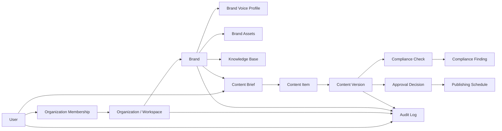
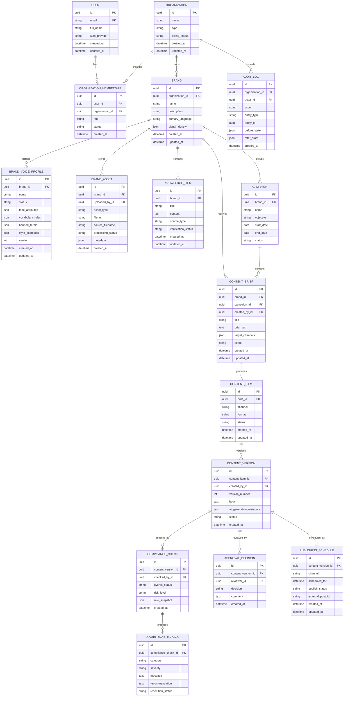
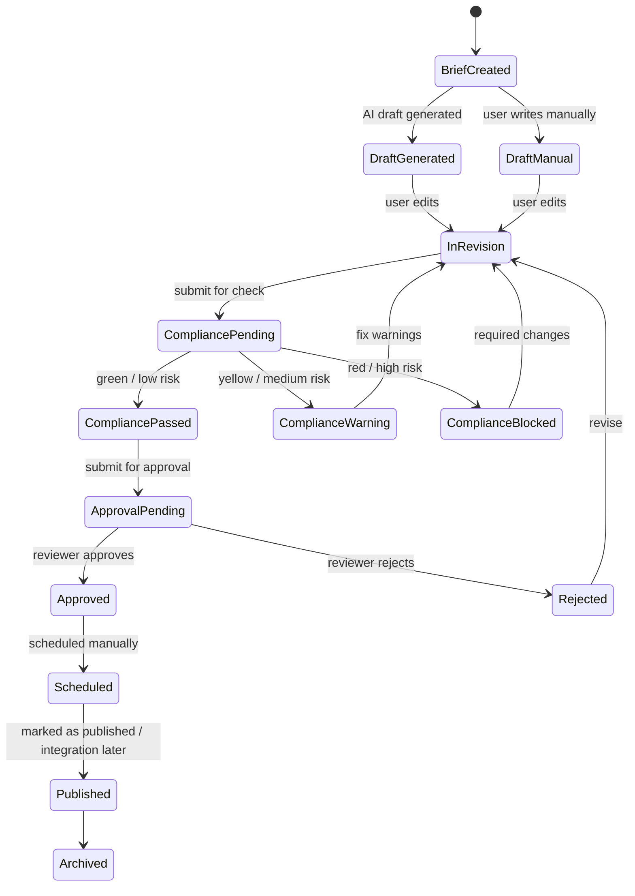
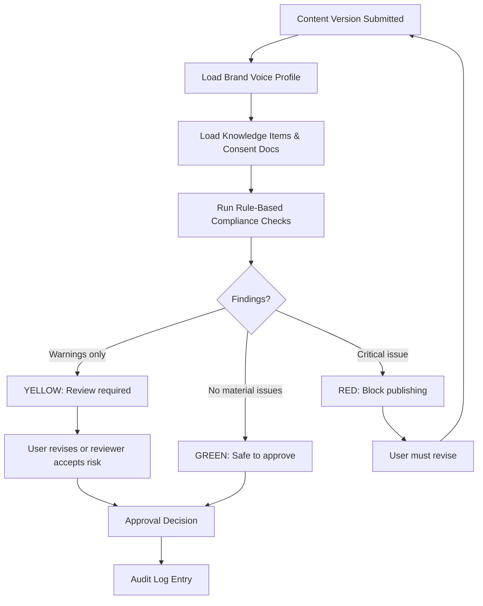
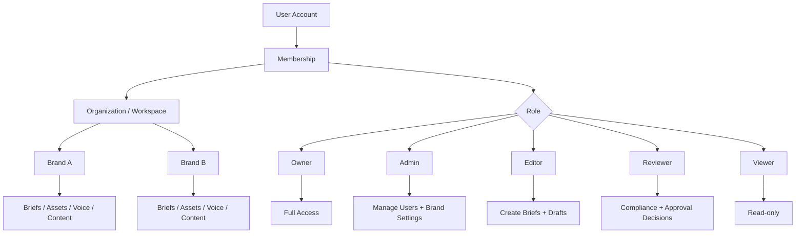

# THE LUXE — Data Model Review & Source-of-Truth Diagrams

## Executive Summary

THE LUXE should be modeled as a multi-tenant AI workflow and compliance cockpit, not as a simple content generator. The data model must preserve five core product truths: organizations/clients own workspaces; brands own voice profiles and assets; briefs generate content drafts and versions; compliance checks gate approvals and publishing; every material decision is audit logged. For the MVP, the schema should stay compact but structurally future-proof: one organization can have many brands, one brand can have many campaigns/briefs, one brief can produce many content items, each content item can have many versions, each version can be reviewed for compliance, and approved versions can be scheduled for publication.

## Canonical Bounded Contexts

| Context | Purpose | MVP? |
|---|---|---|
| Identity & Tenancy | Users, organizations, memberships, roles | Yes |
| Brand Intelligence | Brand profiles, voice profiles, guidelines, sample posts | Yes |
| Asset & Knowledge Base | Uploaded files, consent docs, factual knowledge items | Yes, light |
| Content Workflow | Briefs, generated drafts, content items, versions | Yes |
| Compliance | GDPR/IP/consent/trademark checks, traffic-light results | Yes, light |
| Approval & Audit | Approval decisions, comments, immutable audit trail | Yes |
| Publishing Calendar | Scheduled content, publishing status | Yes, manual-first |
| Integrations | LinkedIn/Meta/etc. connectors | Later |
| Billing | Plans, subscriptions, usage limits | Later unless needed for pilots |
| Analytics | Time saved, performance metrics, template KPIs | Later |

## Diagram 1 — Product/Data Context Map



## Diagram 2 — MVP Entity Relationship Diagram



## Diagram 3 — Content Lifecycle State Machine



## Diagram 4 — Compliance Traffic-Light Flow



## Diagram 5 — Multi-Tenant Access Model



## Recommended Django Apps

```text
backend/
  apps/
    accounts/       # User proxy, organizations, memberships, RBAC
    brands/         # Brand, brand voice profiles, guidelines
    assets/         # Uploads, source materials, consent files
    knowledge/      # Brand/product facts and RAG-ready content
    content/        # Briefs, content items, versions
    compliance/     # Checks, findings, rule snapshots
    workflow/       # Approvals, comments, status transitions
    publishing/     # Calendar and scheduled posts
    audit/          # Immutable audit trail
    ai/             # Provider calls, generation runs, prompt logs
    billing/        # Later: plans, subscriptions, quotas
```

## MVP Schema Priority

### Must Build First

1. User
2. Organization
3. OrganizationMembership
4. Brand
5. BrandVoiceProfile
6. BrandAsset
7. KnowledgeItem
8. ContentBrief
9. ContentItem
10. ContentVersion
11. ComplianceCheck
12. ComplianceFinding
13. ApprovalDecision
14. PublishingSchedule
15. AuditLog

### Defer Until V1/V2

- Billing subscriptions
- Advanced usage metering
- Social platform OAuth tokens
- External publishing API payload logs
- Analytics events
- Template performance metrics
- Vector embedding tables, unless RAG is implemented immediately
- Multi-brand agency permission overrides

## Review Findings

### Correct Direction

- The model should be multi-tenant from day one.
- BrandVoiceProfile should be a first-class model, not just a JSON field on Brand.
- ContentVersion is essential because THE LUXE promises version transparency, warnings, and approvals.
- Compliance checks must attach to a specific ContentVersion, not only to ContentItem.
- AuditLog must be broad enough to record workflow events, approval changes, compliance checks, and publishing transitions.

### Common Mistakes to Avoid

- Do not put all content text directly on ContentBrief.
- Do not make one Content model without versions.
- Do not attach compliance status only to the brief.
- Do not build publishing integrations before manual scheduling works.
- Do not hardcode one user equals one brand; agencies require many brands per organization.
- Do not store proprietary compliance heuristics in frontend-visible structures.
- Do not expose prompt internals or rule snapshots to unauthorized frontend users.

## Backend/Frontend Source-of-Truth Contract

The backend owns:

- Entity definitions
- Status transition rules
- RBAC enforcement
- Compliance scoring
- Audit logging
- AI prompt orchestration
- File processing state

The frontend owns:

- Form state
- UI rendering
- Dashboard cards
- Calendar display
- Review queue display
- Optimistic UI only when backend supports rollback

The frontend must not duplicate:

- Compliance scoring logic
- Approval state machine logic
- Role authorization logic
- Brand voice extraction logic

## API Surface Sketch

```text
/api/orgs/
/api/orgs/{org_id}/memberships/
/api/brands/
/api/brands/{brand_id}/voice-profiles/
/api/brands/{brand_id}/assets/
/api/brands/{brand_id}/knowledge-items/
/api/briefs/
/api/briefs/{brief_id}/generate/
/api/content-items/
/api/content-items/{id}/versions/
/api/content-versions/{id}/compliance-checks/
/api/content-versions/{id}/approval-decisions/
/api/publishing-schedules/
/api/audit-logs/
```

## Next Implementation Order

1. Create Django apps and base UUID/timestamp mixins.
2. Implement accounts, organizations, memberships, and roles.
3. Implement Brand and BrandVoiceProfile.
4. Implement ContentBrief, ContentItem, and ContentVersion.
5. Implement ComplianceCheck and ComplianceFinding with rule snapshots.
6. Implement ApprovalDecision and PublishingSchedule.
7. Add AuditLog and signals/service-layer audit recording.
8. Expose DRF serializers/viewsets.
9. Generate OpenAPI schema and consume types in Next.js.
10. Align frontend dashboard mock data with real API response shapes.

