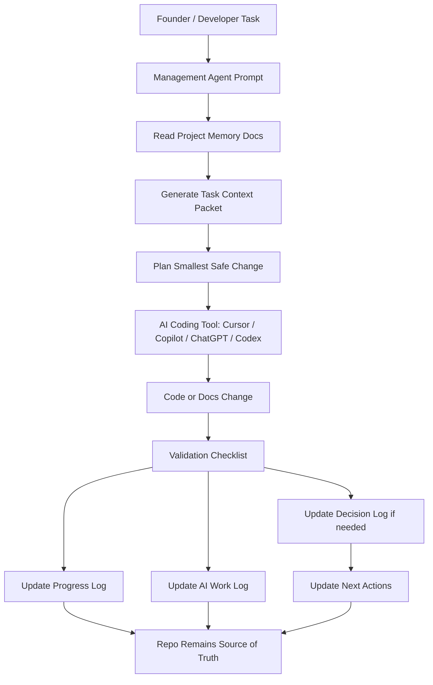

## Executive Summary

Build a **THE LUXE Management Agent** as a repo-level AI operating system. Its job is not to generate product features directly. Its job is to make every AI tool start from the same truth: project brief, architecture, decisions, progress, current priorities, constraints, and founder rules.

For THE LUXE, this is especially important because the product already has a clear identity: an AI workflow cockpit with Brand-Voice Profiles, GDPR/IP/consent-aware checks, audit trail, approvals, and publishing flow . The management agent should therefore protect product focus, prevent scattered architecture, and keep AI work aligned with the current MVP path: brand voice, multi-channel drafting, compliance traffic light, calendar, approvals, and auditability .

Current AI tooling supports this approach: GitHub Copilot supports repository custom instructions through `.github/copilot-instructions.md`, Cursor supports persistent Project Rules and `AGENTS.md`, and ChatGPT Projects can use uploaded files, chats, and custom instructions as shared project context ([GitHub Docs][1]).

---

## Extracted Requirements

### Product Context

THE LUXE is an AI-supported workflow and compliance platform for creators, SMEs, NGOs, agencies, and founders. It combines:

| Area                            | Meaning for the Management Agent                                             |
| ------------------------------- | ---------------------------------------------------------------------------- |
| Brand-Voice Engine              | Agent must preserve brand voice and not allow generic content/product drift. |
| Multi-channel drafting          | Agent must track which channels/features are MVP vs later.                   |
| Compliance traffic light        | Agent must force documentation of GDPR/IP/consent decisions.                 |
| Workflow cockpit                | Agent must keep modules coordinated instead of isolated.                     |
| Publishing calendar & approvals | Agent must track state, ownership, blockers, and next actions.               |
| Audit trail                     | Agent must log what changed, why, and which AI tool helped.                  |

The project strategy also has founder constraints: bootstrap-first, protect IP, avoid full-time restrictive funding, avoid premature dilution, and prioritize product validation before external funding .

### Management Agent Requirements

The management agent must:

| Requirement            | Description                                                                                     |
| ---------------------- | ----------------------------------------------------------------------------------------------- |
| Central project memory | Maintain canonical repo docs instead of relying on chat history.                                |
| Context loading        | Read project files before every coding/planning task.                                           |
| Task planning          | Convert vague tasks into small safe implementation steps.                                       |
| Decision tracking      | Detect architecture/product decisions and propose decision-log entries.                         |
| Progress tracking      | Update progress logs after meaningful work.                                                     |
| AI work tracking       | Record which AI tool changed what and whether it was accepted.                                  |
| Constraint enforcement | Protect MVP scope, IP ownership, budget, and technical simplicity.                              |
| Risk detection         | Flag overengineering, duplicated systems, privacy risks, and architecture drift.                |
| Tool alignment         | Provide shared instructions for ChatGPT, Cursor, Copilot, Codex-style agents, and future tools. |
| Human control          | Never make major architecture or funding/product pivots without explicit founder approval.      |

### Non-Functional Requirements

| Area            | Requirement                                                                                 |
| --------------- | ------------------------------------------------------------------------------------------- |
| Maintainability | Markdown-first, easy to edit manually.                                                      |
| Traceability    | Every major decision should map to progress, decision, or AI work logs.                     |
| Security        | No secrets, API keys, credentials, private user data, or production tokens in docs.         |
| GDPR            | Track privacy assumptions, data categories, consent, retention, and third-party processors. |
| Cost            | Start with files in repo. Avoid databases or complex tooling until needed.                  |
| Reliability     | Agent must fail safely by asking for missing context or proposing a minimal next step.      |
| Scalability     | Later upgrade from Markdown to structured database/Supabase memory if needed.               |

---

## MVP Definition

### MVP Management Agent

Start with a **Markdown-based Project Memory System** plus one reusable management prompt.

Minimum files:

```txt
/project-root
  AGENTS.md
  README.md
  CHANGELOG.md

  docs/
    00_PROJECT_BRIEF.md
    01_ARCHITECTURE.md
    02_DECISIONS.md
    03_PROGRESS_LOG.md
    04_NEXT_ACTIONS.md
    05_AI_WORK_LOG.md
    06_GLOSSARY.md
    07_SETUP_AND_COMMANDS.md
    08_RISK_REGISTER.md
    09_AGENT_OPERATING_SYSTEM.md

  .github/
    copilot-instructions.md

  .cursor/
    rules/
      project-rules.mdc

  prompts/
    management-agent.md
    code-review-agent.md
    feature-implementation-agent.md

  scripts/
    generate-context-packet.ts
    validate-project-memory.ts
```

### MVP Must-Haves

| Must-Have                            | Why                                                                                                                                                                                      |
| ------------------------------------ | ---------------------------------------------------------------------------------------------------------------------------------------------------------------------------------------- |
| `AGENTS.md`                          | Root instruction file for AI agents. GitHub’s docs list `AGENTS.md` as supported for Copilot cloud agent instructions, and Cursor also documents `AGENTS.md` support ([GitHub Docs][2]). |
| `docs/04_NEXT_ACTIONS.md`            | Defines what the AI should work on next.                                                                                                                                                 |
| `docs/02_DECISIONS.md`               | Prevents repeated debates and architecture drift.                                                                                                                                        |
| `docs/03_PROGRESS_LOG.md`            | Replaces scattered chat memory.                                                                                                                                                          |
| `docs/05_AI_WORK_LOG.md`             | Tracks AI-generated changes and human acceptance.                                                                                                                                        |
| `prompts/management-agent.md`        | Reusable prompt for ChatGPT/Cursor/Copilot/Codex-style work.                                                                                                                             |
| `scripts/generate-context-packet.ts` | Creates one compact context file for AI tools.                                                                                                                                           |
| `scripts/validate-project-memory.ts` | Checks whether required docs exist and contain required sections.                                                                                                                        |

### Not MVP Yet

Do **not** build a full agent dashboard, vector DB, autonomous planner, or multi-agent orchestration system yet. Those are V1/V2.

---

## Architecture Proposal

### Recommended Architecture

Use a **repo-native management agent** first.



### Option A — Markdown-First Repo Memory

| Pros                                         | Cons                                          |
| -------------------------------------------- | --------------------------------------------- |
| Fastest to implement.                        | Requires discipline to update docs.           |
| Works with GitHub, Cursor, ChatGPT, Copilot. | No semantic search unless added later.        |
| Easy to version in Git.                      | Can become messy if templates are not strict. |
| Great for MVP.                               | Not ideal for very large teams.               |

**Recommendation:** Use this now.

### Option B — Markdown + Context Generator Script

| Pros                                           | Cons                               |
| ---------------------------------------------- | ---------------------------------- |
| Still simple.                                  | Slight scripting overhead.         |
| Produces compact context packets for AI tools. | Needs maintenance.                 |
| Can validate missing sections.                 | Does not fully automate reasoning. |

**Recommendation:** Add this immediately after the basic files.

### Option C — Supabase/Vector Memory Service

| Pros                                 | Cons                                   |
| ------------------------------------ | -------------------------------------- |
| Queryable memory.                    | Too heavy for current stage.           |
| Can connect to product itself later. | More auth, DB, costs, and maintenance. |
| Enables dashboards and analytics.    | Risk of overengineering before MVP.    |

**Recommendation:** Defer to V1/V2.

---

## Data Model

For MVP, use Markdown files with structured sections. Later, these can map cleanly into database tables.

### Core Entities

| Entity        | Markdown File                                | Purpose                                              |
| ------------- | -------------------------------------------- | ---------------------------------------------------- |
| ProjectBrief  | `00_PROJECT_BRIEF.md`                        | Product identity and boundaries.                     |
| Architecture  | `01_ARCHITECTURE.md`                         | Stack, modules, data flow, design rules.             |
| Decision      | `02_DECISIONS.md`                            | Architecture/product/funding decisions.              |
| ProgressEntry | `03_PROGRESS_LOG.md`                         | What changed per session/date.                       |
| NextAction    | `04_NEXT_ACTIONS.md`                         | Current sprint, tasks, blockers, next task.          |
| AIWorkEntry   | `05_AI_WORK_LOG.md`                          | What AI tool did and review status.                  |
| GlossaryTerm  | `06_GLOSSARY.md`                             | Shared language.                                     |
| Command       | `07_SETUP_AND_COMMANDS.md`                   | Setup, dev, test, deploy commands.                   |
| Risk          | `08_RISK_REGISTER.md`                        | Technical, product, legal, funding, execution risks. |
| AgentRule     | `09_AGENT_OPERATING_SYSTEM.md` / `AGENTS.md` | How AI tools must behave.                            |

### Future Supabase Tables

```txt
projects
decisions
progress_entries
ai_work_entries
tasks
risks
milestones
agent_runs
context_packets
```

For now, keep it in Git.

---

## API Sketch

For MVP, the “API” is file-based. The management agent reads and writes files.

### File-Based Operations

| Operation           | Input                       | Output                               |
| ------------------- | --------------------------- | ------------------------------------ |
| Load context        | `/docs/*.md`, `AGENTS.md`   | Context packet                       |
| Validate memory     | Required docs               | Missing/weak sections report         |
| Plan task           | User task + context packet  | Small safe implementation plan       |
| Log work            | Completed task              | Progress-log and AI-work-log entries |
| Register decision   | Architecture/product change | Decision entry                       |
| Update next actions | Completed/current tasks     | Updated task table                   |

### Future HTTP API

Only build later if needed:

```http
GET /api/project/context
GET /api/project/tasks
POST /api/project/tasks
POST /api/project/progress
POST /api/project/decisions
POST /api/project/ai-work-log
POST /api/project/risks
```

---

## Milestones & Roadmap

### MVP — Repo Memory Agent

| Milestone | Scope                                                            | Complexity |
| --------- | ---------------------------------------------------------------- | ---------- |
| M1        | Add canonical docs folder and templates.                         | S          |
| M2        | Add `AGENTS.md`, Copilot instructions, Cursor rules.             | S          |
| M3        | Add management-agent prompt.                                     | S          |
| M4        | Add context-packet generator script.                             | M          |
| M5        | Add validation script for docs hygiene.                          | M          |
| M6        | Make daily workflow: start task → plan → implement → test → log. | S          |

### V1 — Semi-Automated Project Manager

| Milestone | Scope                                                       | Complexity |
| --------- | ----------------------------------------------------------- | ---------- |
| V1.1      | GitHub Action checks docs are updated in PRs.               | M          |
| V1.2      | Pull request template includes decision/progress checklist. | S          |
| V1.3      | Agent can summarize latest progress from Git diff.          | M          |
| V1.4      | Risk register and backlog sync.                             | M          |
| V1.5      | Weekly founder review template.                             | S          |

### V2 — Productized Internal Agent

| Milestone | Scope                                                  | Complexity |
| --------- | ------------------------------------------------------ | ---------- |
| V2.1      | Store structured memory in Supabase.                   | L          |
| V2.2      | Add semantic search over docs and decisions.           | L          |
| V2.3      | Add project dashboard inside THE LUXE.                 | L          |
| V2.4      | Add automated sprint planning and milestone analytics. | L          |
| V2.5      | Connect to GitHub Issues/Projects.                     | L          |

---

## Implementation Tasks

### Epic 1 — Project Memory Foundation

| Task                                 | Priority | Acceptance Criteria                                                  |
| ------------------------------------ | -------- | -------------------------------------------------------------------- |
| Create `/docs` memory files          | High     | All required files exist with templates.                             |
| Create `AGENTS.md`                   | High     | Root agent behavior is clear.                                        |
| Create `prompts/management-agent.md` | High     | Can be reused in ChatGPT/Cursor/Copilot.                             |
| Create `04_NEXT_ACTIONS.md`          | High     | Contains current sprint, active tasks, blockers, and best next task. |
| Create `05_AI_WORK_LOG.md`           | Medium   | Tracks AI task, output, files changed, review status.                |

### Epic 2 — Tool Integration

| Task                                  | Priority | Acceptance Criteria                                     |
| ------------------------------------- | -------- | ------------------------------------------------------- |
| Add `.github/copilot-instructions.md` | High     | Points Copilot to `/docs` and `AGENTS.md`.              |
| Add `.cursor/rules/project-rules.mdc` | High     | Always applies project rules.                           |
| Add PR template                       | Medium   | Requires progress/decision/task update checklist.       |
| Add GitHub Action                     | Medium   | Validates docs exist and required sections are present. |

### Epic 3 — Management Agent Automation

| Task                           | Priority | Acceptance Criteria                                  |
| ------------------------------ | -------- | ---------------------------------------------------- |
| Build context packet generator | High     | Creates `docs/CURRENT_CONTEXT_PACKET.md`.            |
| Build memory validator         | Medium   | Reports missing sections.                            |
| Add npm scripts                | Medium   | `npm run memory:context`, `npm run memory:validate`. |
| Add tests                      | Medium   | Tests required file detection and context output.    |

---

## Starter Code / Scaffolding

### 1. Root `AGENTS.md`

```md
# THE LUXE Agent Instructions

## Role

You are assisting with THE LUXE, an AI-powered workflow and compliance cockpit for creators, SMEs, NGOs, agencies, and early-stage founders.

Your job is to preserve project direction, avoid scattered architecture, and make the smallest safe improvement aligned with the current MVP.

## Read First

Before making implementation or architecture suggestions, read:

1. `docs/00_PROJECT_BRIEF.md`
2. `docs/01_ARCHITECTURE.md`
3. `docs/02_DECISIONS.md`
4. `docs/03_PROGRESS_LOG.md`
5. `docs/04_NEXT_ACTIONS.md`
6. `docs/05_AI_WORK_LOG.md`
7. `docs/07_SETUP_AND_COMMANDS.md`

## Core Product Focus & Current State
THE LUXE is currently in an `api_ready` backend state, but a `mock_only` to `partial` frontend state. 
- **Data Shape Boundary:** Backend DRF serializers intentionally return `camelCase` fields for reads, but write payloads MUST remain `snake_case`.
- **Tenancy:** Workspace isolation is manually duplicated across viewsets via `workspace__memberships__user`. Maintain this pattern for MVP; do not refactor into a global layer without an updated Decision Log.
- **AI Rule:** The `llm` backend app is scaffold-only. **Do not build or integrate real AI orchestration/generation yet.**

## Current Execution Philosophy & Critical Gaps
- **Fix First:** There is a known infrastructure mismatch. The frontend client (`frontend/lib/api/http-client.ts`) reads `NEXT_PUBLIC_API_URL`, but Docker Compose sets `NEXT_PUBLIC_API_BASE_URL`. Fix this before writing new features.
- Prefer small, reversible integration slices over UI overhauls.
- Do not add frontend state engines; use local React state or lightweight context wrapped around our explicit API clients.


## Required Output After Work

After every meaningful change, provide:

1. Files changed
2. Why the change was made
3. How to test or verify it
4. Suggested `03_PROGRESS_LOG.md` entry
5. Suggested `05_AI_WORK_LOG.md` entry
6. Whether `02_DECISIONS.md` needs an update
7. Next recommended task

## Safety Rules

Never store secrets, API keys, customer private data, or credentials in documentation.

When handling compliance-related logic, distinguish between:
- Product support
- Compliance checklist
- Legal advice

Do not claim legal certification unless reviewed by a qualified professional.
```

---

### 2. `prompts/management-agent.md`

```md
# THE LUXE Management Agent Prompt

You are the THE LUXE Management Agent.

Your purpose is to maintain project continuity, enforce project constraints, and help the founder move from prototype to MVP without architecture drift.

## Mandatory Context

Before answering or changing code, read:

- `AGENTS.md`
- `docs/00_PROJECT_BRIEF.md`
- `docs/01_ARCHITECTURE.md`
- `docs/02_DECISIONS.md`
- `docs/03_PROGRESS_LOG.md`
- `docs/04_NEXT_ACTIONS.md`
- `docs/05_AI_WORK_LOG.md`
- `docs/07_SETUP_AND_COMMANDS.md`

## Operating Procedure

For every task:

1. Restate the task in one sentence.
2. Identify which project files are relevant.
3. Identify whether this is:
   - product task
   - architecture task
   - frontend task
   - backend task
   - AI workflow task
   - compliance task
   - documentation task
   - founder/business task
4. Check current decisions and constraints.
5. Propose the smallest safe plan.
6. Identify files likely to change.
7. Implement only the requested scope.
8. Provide verification steps.
9. Propose progress-log and AI-work-log entries.
10. Update next action recommendation.

## Hard Constraints

- Do not rewrite unrelated code.
- Do not create duplicate modules.
- Do not add dependencies unless justified.
- Do not invent product requirements.
- Do not make large architecture changes without a decision-log entry.
- Do not expose proprietary logic unnecessarily.
- Do not store secrets in repo docs.
- Do not treat compliance checks as formal legal advice.

## Output Format

Return:

## Task Understanding
## Relevant Context
## Proposed Plan
## Files To Inspect
## Files To Change
## Implementation
## Verification Steps
## Progress Log Entry
## AI Work Log Entry
## Decision Log Needed?
## Next Recommended Task
```

---

### 3. `.github/copilot-instructions.md`

```md
# GitHub Copilot Instructions for THE LUXE

Before suggesting code, inspect the project memory:

- `AGENTS.md`
- `docs/00_PROJECT_BRIEF.md`
- `docs/01_ARCHITECTURE.md`
- `docs/02_DECISIONS.md`
- `docs/03_PROGRESS_LOG.md`
- `docs/04_NEXT_ACTIONS.md`
- `docs/05_AI_WORK_LOG.md`
- `docs/07_SETUP_AND_COMMANDS.md`

## Development Rules

- Use TypeScript where applicable.
- Keep components small, typed, and reusable.
- Follow the existing folder structure.
- Do not rewrite working code unless required.
- Do not add dependencies without explaining why.
- Prefer incremental changes over large refactors.
- Add tests or manual verification steps for meaningful changes.
- Keep environment variables and secrets out of source control.

## Documentation Rules

After meaningful changes, suggest updates to:

- `docs/03_PROGRESS_LOG.md`
- `docs/05_AI_WORK_LOG.md`
- `docs/04_NEXT_ACTIONS.md`

If the change introduces a new architectural or technical direction, update:

- `docs/02_DECISIONS.md`

## Product Rules

Keep THE LUXE aligned with:

- Brand-Voice Engine
- Multi-channel drafting
- Compliance traffic light
- Publishing calendar
- Approval flow
- Audit trail
- GDPR/IP/consent-aware review

Do not expand scope beyond the current MVP unless explicitly requested.
```

---

### 4. `.cursor/rules/project-rules.mdc`

```md
---
description: THE LUXE project-wide AI rules
alwaysApply: true
---

# THE LUXE Cursor Project Rules

Read `AGENTS.md` and `/docs` before making architecture or implementation decisions.

Important files:

- `/docs/00_PROJECT_BRIEF.md`
- `/docs/01_ARCHITECTURE.md`
- `/docs/02_DECISIONS.md`
- `/docs/03_PROGRESS_LOG.md`
- `/docs/04_NEXT_ACTIONS.md`
- `/docs/05_AI_WORK_LOG.md`
- `/docs/07_SETUP_AND_COMMANDS.md`

Rules:

- Do not create duplicate systems.
- Do not introduce new architecture without updating `02_DECISIONS.md`.
- Prefer the smallest safe change.
- Keep implementation aligned with `04_NEXT_ACTIONS.md`.
- When unsure, inspect existing code before generating new code.
- After completing a task, suggest updates for progress log and AI work log.
- Never store secrets, credentials, or private customer data in docs.
```

---

### 5. `docs/09_AGENT_OPERATING_SYSTEM.md`

```md
# Agent Operating System

## Purpose

This file defines how AI tools should work on THE LUXE.

The repo is the source of truth. Chat history is secondary.

## Agent Types

| Agent | Purpose |
|---|---|
| Management Agent | Maintains project memory, priorities, risks, and decisions. |
| Architecture Agent | Reviews system design and scalability. |
| Implementation Agent | Writes code for scoped tasks. |
| Review Agent | Checks correctness, security, maintainability, and tests. |
| Compliance Agent | Reviews GDPR/IP/consent implications at checklist level. |
| Product Agent | Checks user flows, MVP scope, and feature prioritization. |

## Default Workflow

1. Read project context.
2. Identify task type.
3. Check decisions.
4. Check current sprint.
5. Propose small plan.
6. Implement or advise.
7. Verify.
8. Log progress.
9. Suggest next action.

## Decision Trigger

Create or update `02_DECISIONS.md` when a task changes:

- tech stack
- data model
- auth model
- deployment strategy
- AI provider
- compliance approach
- pricing/product packaging
- MVP scope
- integration strategy

## Progress Trigger

Update `03_PROGRESS_LOG.md` after:

- meaningful code changes
- new feature completion
- bug fix
- architecture review
- model/data change
- deployment/configuration change

## AI Work Trigger

Update `05_AI_WORK_LOG.md` whenever AI produced code, docs, prompts, architecture, or reviews.
```

---

### 6. TypeScript Context Packet Generator

Create:

```txt
scripts/generate-context-packet.ts
```

```ts
import { readFileSync, writeFileSync, existsSync } from "node:fs";
import { join } from "node:path";

type MemoryFile = {
  path: string;
  required: boolean;
};

const ROOT = process.cwd();

const MEMORY_FILES: MemoryFile[] = [
  { path: "AGENTS.md", required: true },
  { path: "docs/00_PROJECT_BRIEF.md", required: true },
  { path: "docs/01_ARCHITECTURE.md", required: true },
  { path: "docs/02_DECISIONS.md", required: true },
  { path: "docs/03_PROGRESS_LOG.md", required: true },
  { path: "docs/04_NEXT_ACTIONS.md", required: true },
  { path: "docs/05_AI_WORK_LOG.md", required: true },
  { path: "docs/07_SETUP_AND_COMMANDS.md", required: true },
  { path: "docs/08_RISK_REGISTER.md", required: false },
  { path: "docs/09_AGENT_OPERATING_SYSTEM.md", required: false },
];

function readMemoryFile(file: MemoryFile): string {
  const absolutePath = join(ROOT, file.path);

  if (!existsSync(absolutePath)) {
    if (file.required) {
      throw new Error(`Missing required project memory file: ${file.path}`);
    }

    return `## ${file.path}\n\n_Not created yet._\n`;
  }

  return `## ${file.path}\n\n${readFileSync(absolutePath, "utf8").trim()}\n`;
}

function generateContextPacket(): string {
  const createdAt = new Date().toISOString();

  const sections = MEMORY_FILES.map(readMemoryFile).join("\n\n---\n\n");

  return `# THE LUXE Current Context Packet

Generated: ${createdAt}

This file is generated from canonical project memory files.
Do not edit this file manually. Edit the source files instead.

---

${sections}
`;
}

function main(): void {
  try {
    const packet = generateContextPacket();
    const outputPath = join(ROOT, "docs/CURRENT_CONTEXT_PACKET.md");

    writeFileSync(outputPath, packet, "utf8");

    console.log(`Created ${outputPath}`);
  } catch (error) {
    const message = error instanceof Error ? error.message : "Unknown error";
    console.error(`Failed to generate context packet: ${message}`);
    process.exit(1);
  }
}

main();
```

Add to `package.json`:

```json
{
  "scripts": {
    "memory:context": "tsx scripts/generate-context-packet.ts"
  },
  "devDependencies": {
    "tsx": "^4.19.0",
    "typescript": "^5.0.0"
  }
}
```

---

### 7. Memory Validator Script

Create:

```txt
scripts/validate-project-memory.ts
```

```ts
import { readFileSync, existsSync } from "node:fs";
import { join } from "node:path";

type RequiredSection = {
  file: string;
  sections: string[];
};

const ROOT = process.cwd();

const REQUIRED: RequiredSection[] = [
  {
    file: "docs/00_PROJECT_BRIEF.md",
    sections: [
      "## Project Name",
      "## One-Sentence Description",
      "## Problem",
      "## Target Users",
      "## Core Features",
      "## Current Stage",
      "## Current Priority",
      "## Non-Goals",
      "## Important Constraints",
    ],
  },
  {
    file: "docs/01_ARCHITECTURE.md",
    sections: [
      "## Tech Stack",
      "## Main Modules",
      "## Data Flow",
      "## Important Design Rules",
    ],
  },
  {
    file: "docs/02_DECISIONS.md",
    sections: ["# Technical Decisions", "## Decision Log"],
  },
  {
    file: "docs/04_NEXT_ACTIONS.md",
    sections: [
      "## Current Sprint Goal",
      "## Active Tasks",
      "## Blockers",
      "## Best Next Task for AI",
      "## Do Not Touch Yet",
    ],
  },
];

function validateFile(file: RequiredSection): string[] {
  const path = join(ROOT, file.file);
  const issues: string[] = [];

  if (!existsSync(path)) {
    return [`Missing file: ${file.file}`];
  }

  const content = readFileSync(path, "utf8");

  for (const section of file.sections) {
    if (!content.includes(section)) {
      issues.push(`Missing section in ${file.file}: ${section}`);
    }
  }

  return issues;
}

function main(): void {
  const issues = REQUIRED.flatMap(validateFile);

  if (issues.length === 0) {
    console.log("Project memory validation passed.");
    return;
  }

  console.error("Project memory validation failed:");
  for (const issue of issues) {
    console.error(`- ${issue}`);
  }

  process.exit(1);
}

main();
```

Add:

```json
{
  "scripts": {
    "memory:validate": "tsx scripts/validate-project-memory.ts",
    "memory:check": "npm run memory:validate && npm run memory:context"
  }
}
```

---

## Risks & Tradeoffs

| Risk                      | Why It Matters                                                | Mitigation                                                                        |
| ------------------------- | ------------------------------------------------------------- | --------------------------------------------------------------------------------- |
| Docs become stale         | AI will make wrong decisions from outdated memory.            | End every work session by updating progress and next actions.                     |
| Too many files too early  | Can slow you down.                                            | Start with 4 core docs + `AGENTS.md`; add others gradually.                       |
| AI over-expands MVP       | THE LUXE has many possible directions.                        | Keep `04_NEXT_ACTIONS.md` strict.                                                 |
| Proprietary logic leakage | Compliance scoring and orchestration are defensible assets.   | Keep high-level docs public-safe; keep core heuristics private.                   |
| Compliance overclaiming   | GDPR/IP features can be misunderstood as legal advice.        | Use checklist/review language, not legal certification language.                  |
| Tool inconsistency        | Cursor, Copilot, ChatGPT may read context differently.        | Make tool-specific files short wrappers pointing to the same `/docs` truth.       |
| Founder constraint drift  | Funding/product decisions could conflict with bootstrap plan. | Encode decision pipeline in `02_DECISIONS.md` and `09_AGENT_OPERATING_SYSTEM.md`. |

---

## Next Actions

1. Create these first:

```txt
AGENTS.md
docs/00_PROJECT_BRIEF.md
docs/01_ARCHITECTURE.md
docs/03_PROGRESS_LOG.md
docs/04_NEXT_ACTIONS.md
```

2. Then add:

```txt
docs/02_DECISIONS.md
docs/05_AI_WORK_LOG.md
.github/copilot-instructions.md
.cursor/rules/project-rules.mdc
prompts/management-agent.md
```

3. After that, add the two scripts:

```txt
scripts/generate-context-packet.ts
scripts/validate-project-memory.ts
```

4. Your default work prompt should become:

```md
Before helping me, read `AGENTS.md` and the `/docs` project memory.

Focus on:
- project brief
- architecture
- decisions
- progress log
- next actions
- AI work log

Task:
[insert task]

Do not rewrite unrelated code.
Make the smallest safe change.
After the solution, give me:

1. files changed
2. reasoning
3. verification steps
4. progress-log entry
5. AI-work-log entry
6. whether a decision-log update is needed
7. next recommended task
```

This gives you a practical Management Agent without overbuilding. The repo becomes the truth, AI tools become interchangeable workers, and your project direction stays controlled.

[1]: https://docs.github.com/copilot/customizing-copilot/adding-custom-instructions-for-github-copilot?utm_source=chatgpt.com "Adding repository custom instructions for GitHub Copilot"
[2]: https://docs.github.com/en/copilot/reference/custom-instructions-support?utm_source=chatgpt.com "Support for different types of custom instructions"
